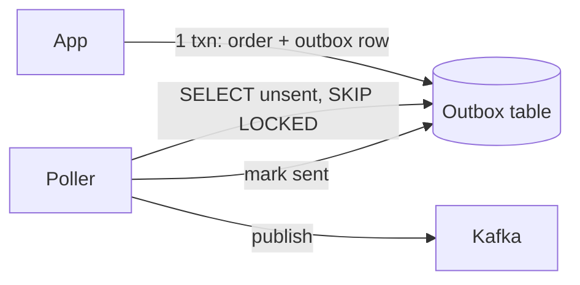
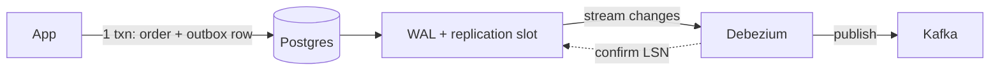

### When to use it?

Use another table in the database as the outbox table, a poller/CDC can read from this table and deliver the message to kafka. That event can be marked as processed or deleted. 
In an outbox table we can store some attributes of the data in the main table and store the event as the payload:

```sql
CREATE TABLE outbox (
  id              BIGSERIAL PRIMARY KEY,      -- or UUIDv7 / ULID (time-ordered)
  event_id        UUID NOT NULL UNIQUE,       -- dedupe key consumers use
  aggregate_type  VARCHAR(64)  NOT NULL,      -- e.g. 'InventoryItem'
  aggregate_id    VARCHAR(128) NOT NULL,      -- e.g. SKU / ledger account id
  event_type      VARCHAR(128) NOT NULL,      -- e.g. 'StockReserved'
  payload         JSONB NOT NULL,             -- or BYTES (Avro/Proto)
  headers         JSONB,                      -- trace id, schema version, tenant
  created_at      TIMESTAMPTZ NOT NULL DEFAULT now(),
  published_at    TIMESTAMPTZ,                -- NULL = pending
  attempts        INT NOT NULL DEFAULT 0,
  last_error      TEXT
);

CREATE INDEX idx_outbox_pending ON outbox (id) WHERE published_at IS NULL;
```

### Idempotent Consumer
Here a poller or CDC gets these new events and publish them to kafka, but it can fail and it might retry the sent events. We need an idempotent consumer here so we will not duplicate the events. [[Idempotent Consumer]].

### Poller vs CDC
----
- Moderate volume (a few hundred to a few thousand events/sec), and latency of up to a second is fine → **poller.** It’s simpler and fails gently.
- High volume, latency under ~100ms, or the company already runs Debezium → **CDC.**

Both write the **order + outbox row in one transaction**. They differ only in how the event reaches Kafka.
###### Poller — asks the table again and again



| Gains                       | Cost                    |
| --------------------------- | ----------------------- |
| Simple, no new infra        | Slower (poll interval)  |
| If it stops, rows just wait | Constant load on the DB |

##### CDC — told about every commit via the WAL



**LSN (Log Sequence Number)** = a position in the WAL, like a page number.

- Debezium tells Postgres: "I've safely published up to LSN X."
- Postgres can then delete WAL before X.
- On restart, Debezium resumes from its last saved LSN.
- If Debezium stops confirming, Postgres keeps all WAL after X → disk fills.

|Pros|Cons|
|---|---|
|Fast, no polling load|More infra to run|
|Keeps commit order|If it stops, WAL fills the disk|

##### Both
- **At-least-once** → consumers dedupe on `event_id`.

> **Say this:** "Start with a poller. Switch to CDC if volume or latency needs grow. The outbox table stays the same."

### Tradeoffs
----
**Gains**:
1. We can use transactions as well as retry as we want. No duplicates.
2. Consistent and reliable
**Cost**:
3. That we might need an idempotent consumer here, which is easy to implement.
4. Depends in the poller how much time will it take to deliver to kafka
5. Restricted to db only
6. In increases storage and complexity of the system
7. Hit on performance